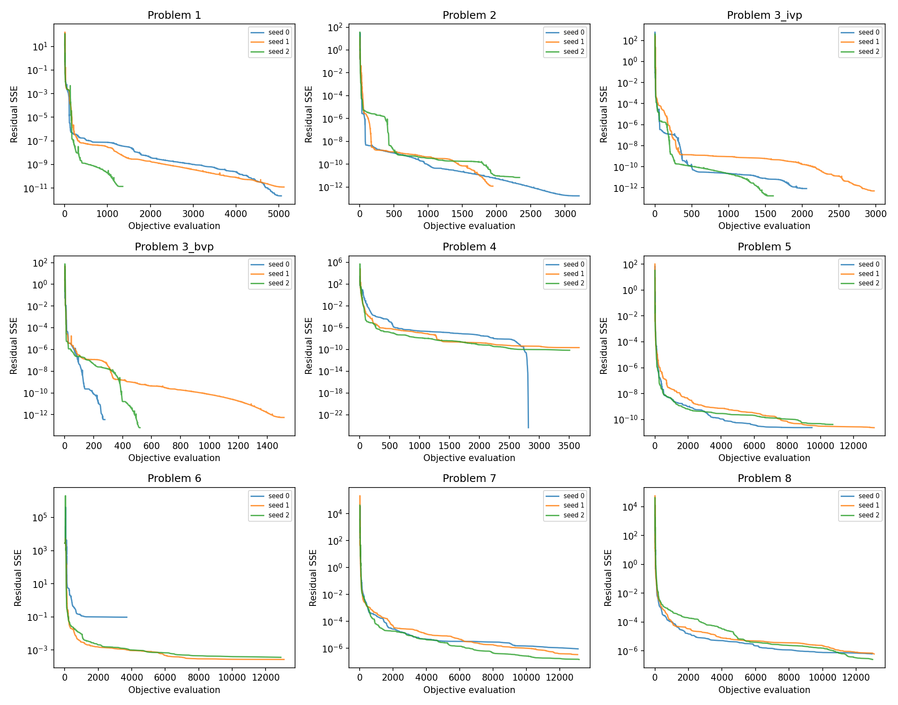
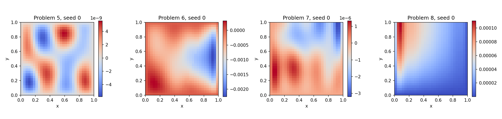
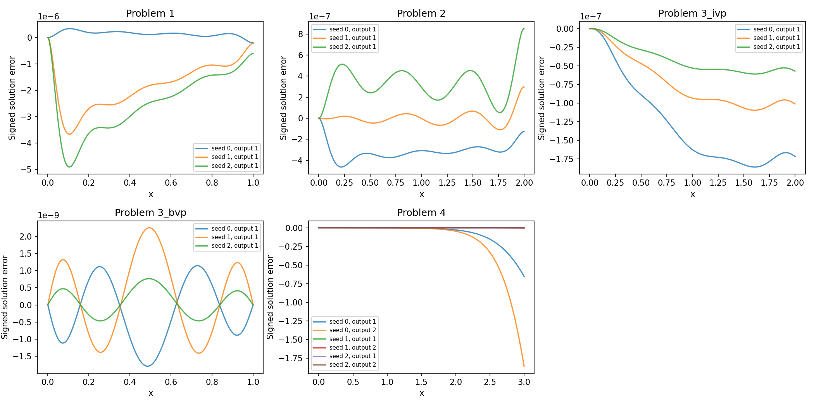

# Neural differential equations: a paper reproduction

An independent PyTorch implementation and **actual CPU training runs** of all eight numbered examples in [Lagaris, Likas and Fotiadis, *Artificial Neural Networks for Solving Ordinary and Partial Differential Equations*, arXiv:physics/9705023v1 (1997)](https://arxiv.org/abs/physics/9705023). The related journal article appeared in IEEE Transactions on Neural Networks in 1998; **this repository pins the 1997 preprint**, whose equations and Table 1 are the reference here.

The network learns a solution to a differential equation from its residual, without labeled interior training data. Initial and boundary conditions are enforced by the trial function itself. This is a small, foundational example of neural scientific computing.

## What is reproduced

| Paper example | Implementation |
|---|---|
| 1–2 | First-order ODEs |
| 3 | Both second-order initial-value and boundary-value variants |
| 4 | Two coupled nonlinear first-order ODEs, separate networks |
| 5–6 | Two Poisson equations with Dirichlet boundaries |
| 7 | Poisson equation with mixed Dirichlet/Neumann boundaries |
| 8 | Nonlinear PDE with mixed boundaries |
| Section 4.3 | Independent biquadratic Galerkin finite-element implementation for 5–8 |

There are nine neural cases and three predetermined seeds each: **27 trained checkpoints**. Each network has ten logistic sigmoid hidden units and a linear output without output bias: 30 parameters for one ODE network and 40 for a PDE network. Problem 4 has two independent networks, totaling 60 parameters. Training minimizes the **sum** of squared equation residuals using full BFGS and float64 arithmetic. Exact solutions are used for boundary data and evaluation, never as interior training labels.

## Run it

Python 3.11 is the tested runtime. A GPU and external datasets are unnecessary.

```bash
python -m venv .venv
# Windows: .venv\Scripts\activate
# Linux/macOS: source .venv/bin/activate
pip install -r requirements.txt
python -m unittest discover -v
python train.py
python fem.py
python verify_artifacts.py
python report.py
python infer.py --case 5 --seed 0
```

For one experiment: `python train.py --cases 5 --seeds 0 --out scratch-results`.
To continue interrupted runs without overwriting completed checkpoints: `python train.py --skip-existing`.
Training a subset into the existing results directory leaves other case files there; use a new directory for a clean independent run. The main report reads the committed `results` directory.

[reproduce.ipynb](reproduce.ipynb) is an optional notebook entry point for Kaggle or Jupyter. The committed measurements were trained locally on CPU; the notebook itself has not been executed on Kaggle.

## Evidence and results

- [Measured tables and interpretation](results/REPORT.md)
- [All per-run metrics in CSV](results/metrics.csv)
- `results/problem_*_seed_*.pt`: trained weights and case/seed metadata; reload with `infer.py`.
- Matching JSON files: runtime, optimizer status, training loss, solution errors and extrapolation errors.
- Matching NPZ files: test coordinates, predictions, analytic references, signed errors and every objective evaluation's loss (including line-search evaluations).
- `results/fem_*.npz` and JSON: solved nodal coefficients, interpolation predictions and Newton residuals.
- `results/environment.json`: package versions, runtime platform and training configuration.







## Fidelity and limits

This reproduces the **complete numerical problem suite and baseline method**, but does not claim identical historical results or software. Important differences and ambiguities are explicit:

1. SciPy BFGS replaces Merlin BFGS. PyTorch computes parameter gradients. PDE training uses analytic sigmoid input derivatives and cached fixed boundary derivatives for speed; tests check both residuals and parameter gradients against a separate full-autograd path. Initialization uses PyTorch defaults with seeds 0, 1 and 2; the preprint does not give recoverable initial weights, seeds or an exact gradient stopping tolerance. We use `gtol=1e-10`, at most 12,000 iterations, one CPU thread.
2. The stated ten-point equidistant grids and 10×10 PDE grid include endpoints. Problem 4's training count is not explicitly restated in its subsection; we assume ten points consistently with the preceding ODE cases.
3. Neural PDE evaluation uses 30×30 cell centers (900 points disjoint from the 10×10 training grid), since the paper does not precisely specify the 900-point coordinates. ODE evaluation uses 1,000 cell centers and 201 extrapolation points up to 20% beyond the right endpoint. Metrics approximate suprema on these finite sets, not certified domain-wide bounds.
4. FEM uses the paper's 18×18 Q2 elements, 37×37 nodes (1,369 total nodal values), nine-point Gaussian quadrature, explicit sparse Newton Jacobians and 23×23 interpolation grid. Dirichlet values are eliminated, so free unknowns are fewer than total nodes. A fixed small random initial guess is used. Exact original mesh numbering and initialization are unavailable.
5. Equation (18) is implemented directly as general transfinite boundary interpolation; this avoids relying on the preprint's expanded Problem 5 boundary expression, which has a sign inconsistency. Boundary tests verify the resulting construction. Problem 6's forcing is transcribed explicitly and independently checked against automatic derivatives of its analytic solution.
6. Published numbers are retained as reference values, not targets used to tune seeds. All runs, including optimizer warnings and inaccurate solutions, remain visible. An extremely small collocation loss can coexist with a poor solution, especially for Problem 4. The experiment does **not** establish universal neural superiority over FEM.
7. Original plots are replaced by regenerated training curves, signed error maps, machine-readable predictions and metrics. Theory and prose are not reproduced verbatim. No original paper PDF or third-party source code is redistributed.

## Validation

The tests check every analytic solution against the independently implemented differential operator, exact boundary enforcement for untrained random networks, objective gradients against finite differences, Q2 polynomial reproduction and error reduction under FEM mesh refinement. Checkpoint reload is exercised separately with `infer.py`.

`verify_artifacts.py` reloads all 27 checkpoints and recomputes saved predictions, exact references, maximum errors and training residuals through the full-autograd reference implementation. It also records residual RMSE on independent test coordinates in `results/verification.json`. Recorded training time includes completed saved runs, excluding interrupted attempts and diagnostic smoke runs. The remaining PDE cases were run concurrently in separate processes, each with one PyTorch thread; the sum of per-run times is therefore not the elapsed duration of the whole project.

## Files

`lagaris.py` contains networks, boundary trial functions and equations. `train.py` runs BFGS. `fem.py` implements the baseline. `report.py` regenerates tables and figures. `test_lagaris.py` and `test_fem.py` validate the numerical implementation.

## Citation

```bibtex
@article{lagaris1997neural,
  title={Artificial Neural Networks for Solving Ordinary and Partial Differential Equations},
  author={Lagaris, I. E. and Likas, A. and Fotiadis, D. I.},
  year={1997},
  eprint={physics/9705023},
  archivePrefix={arXiv}
}
```
